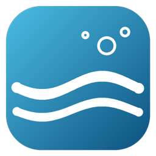
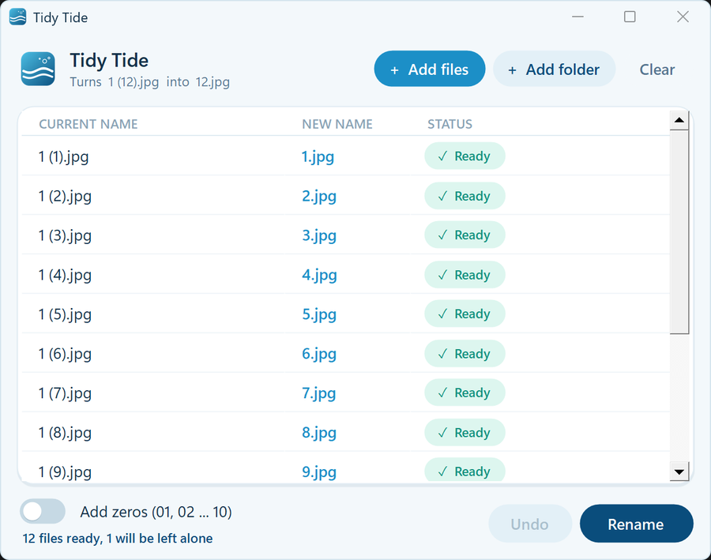
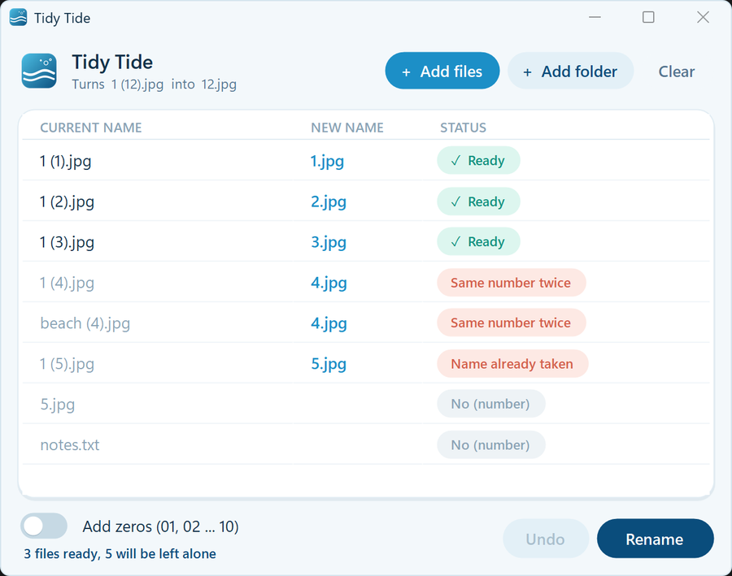
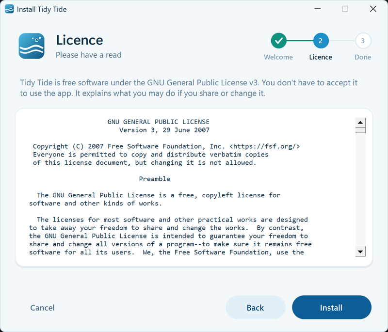
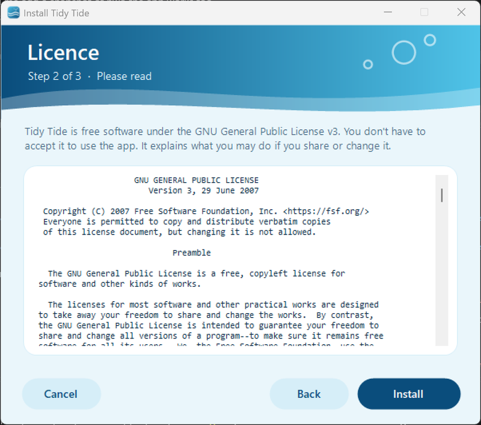
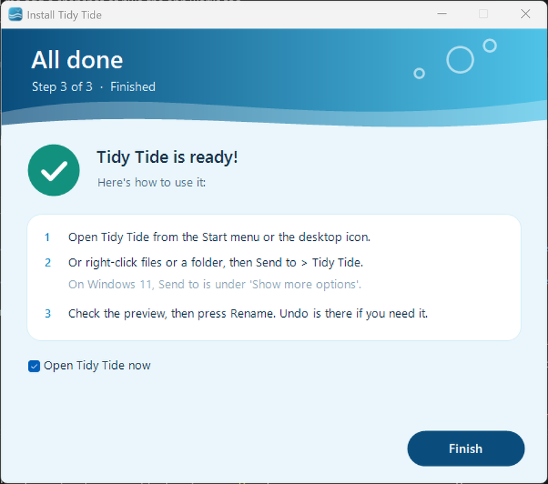

<p align="center">
  
</p>

<h1 align="center">Tidy Tide</h1>

<p align="center">A small Windows app that turns <code>1 (1).jpg</code>, <code>1 (2).jpg</code> … into <code>1.jpg</code>, <code>2.jpg</code> …</p>

<p align="center">
  <a href="https://tidytide.vercel.app"><b>Website</b></a> ·
  <a href="https://github.com/inomisay/TidyTide/archive/refs/heads/main.zip"><b>Download</b></a> ·
  <a href="https://github.com/sponsors/inomisay"><b>♥ Sponsor</b></a> ·
  <a href="LICENSE">GPL-3.0</a>
</p>

---

When you select a bunch of photos in Windows, press **F2** and type `1`, Windows names them `1 (1)`, `1 (2)`, `1 (3)` and so on. If you just want `1`, `2`, `3`, you end up fixing every name by hand. Tidy Tide does that for you.

Drop the files in and check the preview. Then press **Rename**. If something looks wrong, press **Undo**.

<p align="center">
  
</p>

## How it works

1. **Add your files.** Drag them onto the window, use **Add files** / **Add folder**, or right-click them in File Explorer and choose **Send to → Tidy Tide**.
2. **Check the preview.** Every file shows its new name and a status:
   - **Ready**: it will be renamed.
   - **No (number)**: left alone, because the name doesn't end in a number in brackets.
   - **Same number twice**: left alone, because two files would get the same new name.
   - **Name already taken**: left alone, because a file with the new name already exists.

   
3. **Press Rename.** Only the files marked Ready are renamed. Nothing is ever overwritten.
4. **Changed your mind?** Press **Undo** to put the names back.

Tick **Add zeros in front** to get `01`, `02` … `12` instead of `1`, `2` … `12`, so every app lists them in the right order.

## What it does

- Takes the number in the brackets and makes it the whole name: `1 (12).jpg` → `12.jpg`. Any name works: `photo (7).png` → `7.png`, `(3).png` → `3.png`
- Shows every change before it happens
- Can add zeros in front (`01`, `02` … `10`) so every app sorts the files in the right order
- Leaves a file alone if it has no number in brackets, if two files would end up with the same name, or if the new name is already taken. It never overwrites anything.
- Lets you undo the last rename
- Adds itself to the right-click **Send to** menu

## Install

1. Download this repo (green **Code** button → **Download ZIP**) and unzip it.
2. Double-click `Install Tidy Tide.bat`.
3. The installer walks you through three short steps: **Welcome → Licence → Done**. Click **Install** on the licence page.
4. Open Tidy Tide from the desktop icon or the Start menu.

<p align="center">
  
  
  
</p>

If Windows shows "Windows protected your PC", click **More info** → **Run anyway**. Windows shows this for scripts that come from the internet.

To use it from File Explorer, right-click some files or a folder and choose **Send to → Tidy Tide**. On Windows 11, **Send to** is under **Show more options**.

To remove it, run `Uninstall Tidy Tide.bat`.

## Requirements

Windows 10 or 11. Nothing else needs to be installed: it runs on the PowerShell 5.1 and .NET Framework that come with Windows.

## How it's built

It's a PowerShell script with a Windows Forms window. The rounded cards, pill buttons, toggle switch and status badges are drawn by hand with GDI+. It draws at your screen's real resolution, so text stays sharp at 150% or 200% scaling, and uses the Windows 11 fonts and title bar when they're available.

```
app/
  TidyTide.ps1   the app
  ui.ps1         shared look: colours, fonts, sharp high-DPI drawing, buttons, cards
  setup.ps1      installs or uninstalls it (copies to %LOCALAPPDATA%\TidyTide and makes shortcuts)
  TidyTide.ico   icon
website/         the project website (static HTML, deployed on Vercel)
assets/screenshots/  screenshots used in this README
tools/
  make_icon.py   redraws the icon (needs Python + Pillow)
```

To run it without installing:

```powershell
powershell -NoProfile -ExecutionPolicy Bypass -STA -File .\app\TidyTide.ps1
```

You can also pass files or folders as arguments and they'll be added to the list.

## Support

Tidy Tide is free and always will be. If it saved you some time, you can support my work on **[GitHub Sponsors](https://github.com/sponsors/inomisay)**. Giving the repo a ⭐ helps too.

## Licence

Copyright (C) 2026 Yasamin Valishariatpanahi

Tidy Tide is free software, released under the **GNU General Public License v3.0**. The full text is in [LICENSE](LICENSE). The installer shows it before it installs anything.

In plain words:

- **You can** use Tidy Tide for anything, for free, including at work.
- **You can** read the code, change it, and share copies, changed or not, for free or for money.
- **If you share it** (the original or your changed version), you must give people the source code under the same GPL-3.0 licence, keep the copyright and licence notices, and say what you changed.
- **You cannot** take it, close the source, and release it under a different licence.
- Tidy Tide comes **with no warranty**. If something goes wrong, the author is not liable.

This is a summary to help you, not legal advice. If anything here differs from [LICENSE](LICENSE), the licence text is what counts.

---

<p align="center">Made by Yasamin Valishariatpanahi · <a href="https://github.com/inomisay">github.com/inomisay</a></p>
